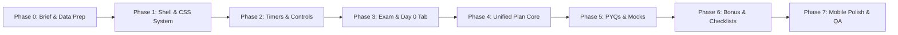

# PROJECT BRIEF: AFCAT 01/2027 + TCS CodeVita Season 14 Unified Study Portal

> **Single Source of Truth** for the development of the static, mobile-first dual-preparation portal.  
> *Last Updated:* November 2026  
> *Target User:* 1 Developer/Candidate preparing concurrently for AFCAT 01/2027 and TCS CodeVita Season 14.

---

## 1. Executive Summary & Goals

### 1.1 The Challenge
The candidate is preparing simultaneously for two demanding milestones:
1. **AFCAT 01/2027 (Indian Air Force Exam):**
   - **Exam Date:** 31 January 2027 (10:00 AM – 12:00 Noon; Report at 08:00 AM; Last Entry 09:00 AM).
   - **Target Branches:** Ground Duty (Non-Technical) – Administration & Logistics.
   - **Format:** 100 Questions, 300 Marks, 2 Hours, +3 / -1 marking scheme, English only.
   - **Key Milestone:** Form closes 11 Dec 2026; Admit Card releases 27 Jan 2027. *(Confirm all dates on official portal)*.
2. **TCS CodeVita Season 14:**
   - **Target:** 8-Week / 56-Day intensive competitive programming preparation.
   - **Cadence:** 5 learning days/week (Mon–Fri: 1.5h video lecture + 1.5h problem solving) + Saturday practice/mock (3 hours) + Sunday rest.
   - **Round 1 Date:** User-configurable date picker (Date not yet published officially; registration closes 13 Nov 2026 - *confirm on official portal*).

### 1.2 The Solution
A unified, static, offline-capable, mobile-first web app that integrates both tracks into a single, cohesive daily timetable and progress-tracking dashboard. It provides countdowns, automated daily schedules, checkbox progress tracking saved directly in the browser's `localStorage`, mock score tracking, a question bank (PYQs), and exam-day checklists.

### 1.3 Reference Inspiration
- **Reference Site:** [perryvegehan.github.io/Codevita](https://perryvegehan.github.io/Codevita/)
- **Adoption Scope:** Adopt the functional architecture, sections, controls, and interaction model.
- **Differentiation:** Custom visual identity (aviation/tactical styling), dual-track unified calendar (merging defence syllabus with DSA), and clean fresher-friendly code.

---

## 2. Technical Architecture & Constraints

| Dimension | Specification |
| :--- | :--- |
| **Tech Stack** | Pure HTML5, modern CSS3 (Custom Properties / Flexbox / Grid), Vanilla JavaScript (ES Modules). |
| **Frameworks / Libraries** | **Zero dependencies, zero build steps, zero package managers.** No React, Vue, Svelte, Tailwind, or Webpack. |
| **Data Architecture** | Pure client-side data consumption from JSON files residing in `/data`. |
| **Persistence** | Browser `localStorage` (task completion state, custom dates, mock scores, notes). |
| **Deployment Target** | **GitHub Pages** (clean relative URLs, completely static assets). |
| **Responsive Target** | **Mobile-First** (optimized for 360px–430px smartphones; seamlessly scalable to tablet and desktop). |
| **Code Style** | Extremely clean, modular, self-documenting code structured for easy maintenance by a fresher developer. |

---

## 3. Data Specification & Workspace Structure

### 3.1 Directory Layout
```text
AFCAT-IT/
├── .git/
├── PROJECT_BRIEF.md          # This source of truth document
├── index.html                # Main application entry point (single-page app structure)
├── css/
│   ├── variables.css         # Theme colors, typography, spacing, breakpoints
│   ├── base.css              # Reset, typography, utility classes
│   ├── components.css        # Buttons, cards, chips, countdowns, progress bars, tables
│   └── layout.css            # Header, sticky bar, sections, responsive grid/flex
├── js/
│   ├── app.js                # Core bootstrap, module orchestration, initial render
│   ├── store.js              # State management & localStorage CRUD operations
│   ├── countdown.js          # Live timer engine for AFCAT & CodeVita Round 1
│   ├── timetable.js          # Daily timetable modal & active time-slot highlighter
│   ├── plan.js               # Dual-track 11-week calendar renderer & checkbox handling
│   ├── pyqs.js               # Question bank table, filtering, sorting, status toggles
│   ├── mocks.js              # AFCAT (12 mocks) & CodeVita mock test trackers & targets
│   └── ui.js                 # Toast notifications, modals, tab switching, "Jump to Today"
└── data/
    ├── plan-data.json        # Key dates, AFCAT syllabus, timetable, mocks, checklists, legend
    └── cv-days.json          # 56-day itemized problem & video items for CodeVita
```

### 3.2 Data Files Schema
1. **`data/plan-data.json`**:
   - `meta`: Overall plan metadata (`plan_start`: "2026-11-16", `plan_end`: "2027-01-31").
   - `key_dates`: Milestone objects with `id`, `label`, and `date` (supports `null` for user-entered dates like CodeVita Round 1).
   - `afcat_facts`: Exam pattern, sections, fee, eligible branches for candidate.
   - `cv_rules`: 56 days, 8 weeks, daily time split (1.5h lecture + 1.5h practice), 5 full mocks in weeks 4–8.
   - `day0`: 4-day pre-launch setup checklist (Thu 12 Nov – Sun 15 Nov 2026: registration, doc scan, baseline mock, notebook prep).
   - `weekday_timetable`: Master daily hourly routine (06:00 to 22:30: workout, Block A, English, CodeVita video, lunch, CodeVita practice, GA, revision, job block, vocab flashcards, sleep).
   - `weeks`: 11-week unified plan:
     - **Weeks 1–8:** Dual-track (Daily AFCAT Block A Maths/Reasoning, English, GA + CodeVita Days 1–56 + Saturday sectionals + Sunday revision/rest).
     - **Weeks 9–11:** AFCAT peak mock sprint, revision, admit card release, travel prep, exam day (31 Jan 2027) + CodeVita daily maintenance.
   - `afcat_mocks`: 12 full-length mocks with progressive target scores (110 → 195).
   - `checklists`: Pre-exam & exam-day checklist items for both AFCAT and CodeVita.
   - `legend`: Task type categories (`Lecture`, `Practice`, `PYQ`, `Mock`, `Revision`, `Job`, `CodeVita video`, `CodeVita problems`, `Stretch`).

2. **`data/cv-days.json`**:
   - Structure: `days: [ { "day": 1..56, "items": [ { "type", "title", "url", "topic", "level" } ] } ]`.
   - Populated progressively by the user or assisted scraping, seamlessly merging into daily cards.

---

## 4. UI/UX Design System & Layout Structure

### 4.1 Aesthetic & Visual Identity
- **Design Philosophy:** Crisp, military-inspired precision meets modern developer ergonomics (tactical, distraction-free, focused).
- **Color Palette:**
  - *Primary Background:* Deep Tactical Navy / Obsidian (`#0B0F19`)
  - *Surface / Card Background:* Charcoal Slate (`#161F30` with subtle `#24324D` border)
  - *Primary Accent (AFCAT / IAF):* Sky & Air Force Blue (`#38BDF8` & `#0284C7`)
  - *Secondary Accent (CodeVita / Tech):* Emerald & Mint (`#10B981` & `#34D399`)
  - *Warning / Action Accent:* Amber / Saffron (`#F59E0B`)
  - *Text Primary:* High-legibility Ice White (`#F8FAFC`)
  - *Text Muted:* Cool Silver / Slate (`#94A3B8`)
- **Typography:** System font stack (`Inter`, `-apple-system`, `BlinkMacSystemFont`, `Segoe UI`, `sans-serif`) with monospace accents for time and counters (`JetBrains Mono`, `Consolas`, `monospace`).

### 4.2 Top Global Header & Sticky Controls Bar
1. **Brand Bar:** Portal Title (`AFCAT 01/2027 + CodeVita S14`), Candidate Focus Badge, Official Portal Disclaimer Indicator.
2. **Dual Countdown Timers:**
   - **AFCAT 01/2027:** Hardcoded target `2027-01-31T08:00:00+05:30` (Days, Hours, Minutes, Seconds).
   - **CodeVita Round 1:** Live countdown linked to user-configured date input (or "Set Date" prompt).
3. **Interactive Control Strip (Sticky on Scroll):**
   - **Start Date Input:** Date picker (default: `2026-11-16`), automatically adjusts day offsets.
   - **Round 1 Date Input:** Date picker for CodeVita (persisted in `localStorage`).
   - **"Jump to Today":** Computes current date offset from start date, auto-expands the corresponding week, and smoothly scrolls to today's card.
   - **Progress Gauge:** Overall % completed, completed tasks count / total tasks count, sub-bars for AFCAT vs CodeVita.
   - **Type Legend & Filter Chips:** Clickable pill chips (`Lecture`, `Practice`, `PYQ`, `Mock`, `Revision`, `Job`, etc.) to highlight or filter tasks.
   - **"Reset My Progress":** Button triggering a modal confirmation to clear checked states without altering custom dates.

### 4.3 Navigation & Section Architecture
The page is organized into 6 clearly demarcated tabs/sections:

```mermaid
flowchart TD
    Nav[Navigation Bar / Tabs] --> Sec1[1. Exam Info & Timetable]
    Nav --> Sec2[2. Unified Plan (11 Weeks)]
    Nav --> Sec3[3. PYQs & Question Bank]
    Nav --> Sec4[4. Mocks Tracker]
    Nav --> Sec5[5. Bonus Resources]
    Nav --> Sec6[6. Exam Day & Checklists]
```

#### Section 1: Exam & Schedule Overview
- **AFCAT 01/2027 Dossier:** Exam pattern card, scoring rules (+3/-1), sections, branch eligibility (Admin & Logistics), and critical dates table.
- **CodeVita S14 Dossier:** Contest format, allowed languages (C, C++, Java, Python), round structure, 8-week guidelines.
- **Day 0 Onboarding Sprint:** Interactive checklist for Thu 12 Nov – Sun 15 Nov (Doc scans, baseline mock, notification download).
- **Master Weekday Timetable:** Visual breakdown of the daily 06:00 – 22:30 routine with a "Current Slot" highlight based on system time.

#### Section 2: Unified Dual-Track Plan (Weeks 1 – 11)
- **Week Accordions:** 11 collapsible week cards (auto-expands current week).
- **Day Cards:** 7 day cards per week (Mon–Fri dual track, Sat sectional/mock, Sun revision/rest).
- **Task Item Rows:**
  - Checkbox (persisted in `localStorage`).
  - Track indicator (Blue badge for AFCAT, Green badge for CodeVita, Purple for General/Job).
  - Category Chip (e.g., `Maths`, `Reasoning`, `English`, `GA`, `Video`, `Problem`, `Speed Drill`).
  - Task description with external links when available.
  - Optional difficulty / duration indicator.

#### Section 3: Question Bank & PYQs
- Filterable, searchable interactive table.
- Columns: Checkbox, Problem/Question Title, Subject/Track (AFCAT vs CodeVita), Topic/Tag, Source (e.g., AFCAT 2024 PYQ, CodeVita S13, LeetCode), Difficulty, Direct Link, Action/Status.
- Quick search bar + topic dropdown filter.

#### Section 4: Mocks & Performance Tracker
- **AFCAT Mock Grid:** 12 Full Mock cards with Target Score (110 to 195), Actual Score input, Date Taken input, and Delta Indicator (Green if target achieved, Amber if below).
- **CodeVita Mock Tests:** 5 x 3-Hour full mocks scheduled across Weeks 4–8 with problem solve counters (e.g., 2/6, 3/6 solved).

#### Section 5: Bonus Resources & Strategy
- Formula sheets & error log best practices.
- High-yield AFCAT static GK / current affairs compendiums.
- DSA pattern cheat sheets & template boilerplates (I/O parsing for CodeVita).

#### Section 6: Exam Day & Survival Checklists
- **AFCAT Exam Day:** Two admit card prints, original Aadhaar, reporting time (08:00 AM), gate closure (09:00 AM), ballpoint pen rules, dress code guidelines.
- **CodeVita Exam Day:** Environment check, webcam/browser configuration, compiler test, 15-minute question triage strategy.
- Interactive checkboxes saved in `localStorage`.

---

## 5. Storage Schema (`localStorage`)

All candidate progress is persisted locally with safe fallbacks and zero telemetry:

```json
{
  "afcat_cv_settings": {
    "startDate": "2026-11-16",
    "cvRound1Date": "2026-12-20",
    "activeFilter": "all",
    "activeTab": "plan"
  },
  "afcat_cv_tasks": {
    "day0_task_0": true,
    "w1_d1_afcat_a": true,
    "w1_d1_cv_video": false,
    "w1_d1_cv_p1": false
  },
  "afcat_cv_mocks": {
    "m1": { "score": 118, "date": "2026-11-28", "completed": true },
    "m2": { "score": null, "date": "", "completed": false }
  },
  "afcat_cv_checklists": {
    "afcat_admit_card_2x": true,
    "afcat_aadhaar_orig": true
  }
}
```

- **Export / Import Feature:** Simple "Backup Progress (JSON)" and "Restore Progress" buttons in settings/footer to enable switching devices or preventing browser cache wipeouts.

---

## 6. Implementation Phasing & Delivery Roadmap

Development must strictly follow this sequential roadmap. **Each phase ends with running the app in the browser, testing its functionality, and providing a visual walkthrough.**



### Phase Details

#### Phase 0: Specification & Data Setup *(CURRENT)*
- Create `PROJECT_BRIEF.md` as the authoritative blueprint.
- Move `plan-data.json` and `cv-days.json` into `/data`.
- Verify data file integrity and JSON validity.
- *Status:* Completed.

#### Phase 1: Foundation, CSS Design System & Data Layer
- Create `index.html` structure with semantic tags.
- Implement CSS variables (`variables.css`), typography/reset (`base.css`), and responsive grid/flex layout (`layout.css`).
- Build asynchronous ES Module loader (`js/store.js`) to load and cache `/data/plan-data.json` and `/data/cv-days.json`.
- Browser verification: Clean page load, no console errors, responsive layout skeleton visible.

#### Phase 2: Header, Countdowns & Interactive Controls Strip
- Implement header branding and official portal disclaimers.
- Build live dual countdowns (`js/countdown.js`) for AFCAT (31 Jan 2027) and CodeVita Round 1 (user input).
- Implement Start Date and Round 1 Date picker inputs connected to `localStorage`.
- Implement dynamic progress bar (% calculation from completed checkboxes).
- Implement "Jump to Today" algorithm and "Reset Progress" modal.
- Implement Type Legend filter chips.
- Browser verification: Live ticking countdowns, date persistence, filter toggles.

#### Phase 3: Exam Info & Day 0 Onboarding Tab
- Render AFCAT 01/2027 pattern, marking scheme, branch eligibility, and key dates.
- Render CodeVita S14 rules and guidelines.
- Render interactive Day 0 (12 Nov – 15 Nov) setup checklist with checkbox state persistence.
- Build interactive Master Weekday Timetable drawer/component with active time-slot highlighting.
- Browser verification: Accordions open/close, Day 0 checkboxes save on refresh.

#### Phase 4: Core Unified 11-Week Plan
- Render all 11 weeks dynamically from `plan-data.json`.
- Integrate daily AFCAT items (Block A, English, GA, Vocab) and CodeVita items (Video + Problems from `cv-days.json`).
- Implement Saturdays (Sectional tests / CodeVita mocks) and Sundays (Revision / Rest).
- Connect task checkboxes to `localStorage` with instantaneous progress bar updates.
- Test "Jump to Today" auto-scrolling to current calendar day.
- Browser verification: Checked items persist across reloads, filtering works smoothly.

#### Phase 5: Question Bank (PYQs) & Mocks Tracker
- Build Question Bank tab with search, topic filtering, difficulty badges, and solved checkboxes.
- Build AFCAT 12-Mock tracker with target score comparison and delta indicators.
- Build CodeVita 5-Mock tracker with problem count logging.
- Browser verification: Score entries compute deltas, search filters items in real time.

#### Phase 6: Bonus Resources & Exam-Day Checklists
- Render strategy resources, formula sheets, and study links.
- Render AFCAT and CodeVita Exam-Day checklists with warning banners.
- Implement JSON Export/Import for backup.
- Browser verification: Checklist persistence, export/import file generation.

#### Phase 7: Mobile Ergonomics, Cross-Device Polish & Final Verification
- Audit viewports (360px, 390px, 768px, 1280px).
- Verify touch targets (min 44px height for interactive elements).
- Perform end-to-end localStorage reset and recovery tests.
- Prepare and verify GitHub Pages deployment readiness (relative paths).

---

## 7. Rules of Engagement for the Agent

1. **Strictly Plain Vanilla:** Absolutely no npm dependencies, build tools, external frameworks, or server-side scripts.
2. **Dynamic Data Separation:** Content must flow from `/data/plan-data.json` and `/data/cv-days.json`. Never hardcode static study content into HTML.
3. **Official Portal Disclaimers:** Any rule, date, fee, or requirement must visibly feature the badge/caption: *"confirm on official portal"*.
4. **Independent Branding & Copy:** Never clone proprietary branding or text from the reference site. Follow only its UX architecture, layout, and feature set.
5. **Cadence & Verification:** Work in incremental steps. Never jump ahead to write app code until the preceding phase is verified in the browser with screenshots and user review.
6. **Code Clarity:** Write clean, legible, and well-commented ES modules that a fresher developer can confidently learn from, maintain, and expand.

