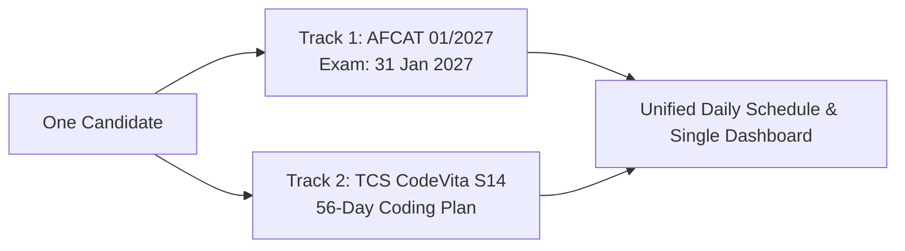

# SPEC.md: Reference Site Analysis & Dual-Track System Specification

> **Document Purpose:** Complete forensic breakdown of the reference site ([perryvegehan.github.io/Codevita](https://perryvegehan.github.io/Codevita/)) based on live browser study at Desktop (1440px) and Mobile (390px) viewports, followed by the exact specification for the **AFCAT 01/2027 + TCS CodeVita Season 14** dual-track study portal.  
> **Accompanying Visual Artifacts:** Located in [`screenshots/`](file:///c:/AFCAT-IT/screenshots) (`reference-desktop.png`, `reference-desktop-full.png`, `reference-mobile.png`, `reference-mobile-full.png`).

---

## Approved Architectural Decisions

1. **Layout & Branding:** Follow the reference site for layout and features. Custom branding: navy/slate base (`#0b1120`, `#0f172a`, `#162033`), Sky Blue (`#38bdf8`) for AFCAT, Emerald (`#10b981`) for CodeVita, Amber (`#f59e0b`) for highlights. Fonts: *Plus Jakarta Sans* (UI) and *JetBrains Mono* (numbers) from Google Fonts with system fallbacks. Logo text: `"A+C Plan"` (not "CV").
2. **Dual Countdown Targets:**
   - **AFCAT Target:** Exam start 31 Jan 2027, 10:00 AM IST. Display `"Report 8:00 AM, last entry 9:00 AM"` as a separate distinct line.
   - **CodeVita Card:** Show registration deadline (`13 Nov 2026, confirm on portal`) until it passes, then display the Round 1 countdown once the user enters a date.
3. **Storage & Task IDs:** Browser `localStorage` key is `afcat-cv-plan-v1`. Item IDs are generated deterministically from the plan day number and item kind (`${day}|${kind}|${key}`), never from calendar dates, ensuring that changing the start date never resets or loses progress.
4. **Progress Counting Rules:** Stretch items are optional and excluded from progress calculations. Rest days are also excluded.
5. **Timeline & Interaction:** Total 77 days across 11 weeks. Week blocks are collapsible. Only today's day card is open by default. The `"Jump to today"` button expands and smoothly scrolls to today's card.
6. **Schedule Fit Note:** Hidden until a Round 1 date is entered (like reference `#fitNote`). Warns if CodeVita Day 56 falls after Round 1, and if Round 1 is within 3 days of 31 Jan 2027, advises cutting AFCAT mocks that week.
7. **Content & Attributions:** CodeVita items reuse the reference only as title + link + type + topic (no copied descriptions). Footer explicitly credits: `"Layout inspired by the CodeVita 8-Week Plan by Padho with Pratyush"`.
8. **Day Card Pattern:** Split-Track Dual Card (AFCAT block, CodeVita block, habits block, dual mini progress badges).
9. **Project Delivery Phases:**
   - Phase 2: Scaffold + Design System *(Current)*
   - Phase 3: Data Loading & State Management
   - Phase 4: Plan Section (Unified 77-Day Calendar)
   - Phase 5: Question Bank, Mocks & Bonus
   - Phase 6: Exam Dossiers & Checklists
   - Phase 7: Polish & Cross-Device Verification
   - Phase 8: Deployment Readiness

---

## Part 1: Forensic Analysis of Reference Site

### 1. Page Structure (Every Section in Order)

The reference site is a single-page document structured into **8 distinct sequential sections**:

```text
┌──────────────────────────────────────────────────────────────┐
│  Sticky Header / Topbar (.topbar)                            │
├──────────────────────────────────────────────────────────────┤
│  1. Hero Section (#top, .hero)                               │
├──────────────────────────────────────────────────────────────┤
│  2. Exam at a Glance (#exam, .section)                       │
├──────────────────────────────────────────────────────────────┤
│  3. The 8-Week Plan (#plan, .section.alt)                    │
├──────────────────────────────────────────────────────────────┤
│  4. CodeVita Question Bank (#pyq, .section)                  │
├──────────────────────────────────────────────────────────────┤
│  5. Mock Tests (#mocks, .section.alt)                        │
├──────────────────────────────────────────────────────────────┤
│  6. Bonus Videos (#bonus, .section)                          │
├──────────────────────────────────────────────────────────────┤
│  7. Exam-Day Checklist (#checklist, .section.alt)            │
├──────────────────────────────────────────────────────────────┤
│  8. Footer (.footer)                                         │
└──────────────────────────────────────────────────────────────┘
```

#### Detailed Breakdown of Each Section:

1. **Header / Topbar (`header.topbar`)**:
   - Left: Logo icon (`.logo`: rounded yellow square with dark text "CV") + brand link (`Padho with Pratyush` linking to `#top`).
   - Center/Right: Navigation links (`Exam`, `Plan`, `PYQs`, `Mocks`, `Bonus`, `Exam day`).
   - Far Right: Theme toggle icon button (`#themeBtn` with SVG moon/sun icon).

2. **Hero Section (`section.hero`)**:
   - Layout: Two-column grid (`.hero-grid`: 1.4fr 1fr on desktop; 1 column stacked on mobile).
   - Left Column (Value Proposition & CTAs):
     - Eyebrow tag: `TCS CodeVita · Season 14`.
     - Heading: H1 `Crack CodeVita in <span class="hl">8 relaxed weeks</span>.`
     - Lede paragraph: Explaining the 56-day schedule, 2.5–3 hours/day, 1 rest day/week, browser auto-saving.
     - CTA Button Row: Primary button `"Start the plan"` (`href="#plan"`) + Ghost button `"Register on the portal ↗"` (`href="https://codevita.tcsapps.com/"` target `_blank`).
   - Right Column (Live Countdown & Progress Card - `aside.count-card`):
     - Countdown header: `"Registration closes in"`
     - Countdown display (`#countdown`): Large dynamic digits formatted as `Xd Xh Xm` (or `"Closed"`).
     - Subtitle: `"13 Nov 2026 · confirm on the official portal"`.
     - Divider line (`.divider`).
     - Progress block:
       - Header row: `"Your progress"` on left, bold percentage (`#progressPct`: e.g. `"0%"`) on right.
       - Progress bar (`.bar > #progressBar`): 10px tall pill track with glowing yellow gradient fill.
       - Sub-text (`#progressText`): `"0 of N items done"` (computed dynamically from all countable tasks).

3. **Exam at a Glance (`section#exam`)**:
   - Section heading: `"The exam at a glance"` + subtitle (`"From the official CodeVita portal. Round dates aren't published yet — last checked 2 Oct 2026."`).
   - Facts Grid (`.facts`): 3 columns desktop, 2 columns tablet, 1 column mobile. Contains 6 cards:
     1. *Duration:* `3 hours per round` (note: *"New this season (Season 13 rounds were 6 hours)"*).
     2. *Languages:* `C, C++, Java, Python` (note: *"Only 4 allowed this season (was 8)"*).
     3. *Eligibility:* `UG / PG, science or engineering` (note: *"Graduating in 2027, 2028, 2029 or 2030"*).
     4. *Advancement:* `Solve more → go further` (note: *"Only the top coders in each round move on"*).
     5. *Rounds 2 & 3:* `May go beyond classic coding` (note: *"Details to be revealed after Round 1"*).
     6. *Prize:* `USD 20,000` (note: *"Shared by top 3 · finalists travel to India"*).
   - Two-Column Detailed Area (`.two-col`):
     - Left Column (*Timeline*): Ordered list (`ol.timeline`) with vertical connecting line and colored state dots (`.live`, `.confirmed`, `.tba`). Shows Registration (Open now), Registration closes (13 Nov 2026), MockVita (TBA), Round 1 (TBA), Rounds 2 & 3 (TBA), Grand Finale (TBA).
     - Right Column (*Rules & Format Warning*): Bulleted list of 6 gotchas (read order, 15-min session timeout, saving code locally, Microsoft Authenticator, Code Attribution, 1-sec Python time limits) + Callout card describing CodeVita's story-style questions and custom formatting.

4. **The 8-Week Plan (`section#plan`)**:
   - Plan Header (`.plan-head`): H2 `"The 8-week plan"` + subtitle explaining the 5 learning days + 1 mock/practice + 1 rest day structure.
   - Plan Controls Bar (`.plan-controls`):
     - Input 1: `"My start date"` (`input#startDate[type="date"]`).
     - Input 2: `"Round 1 date (when announced)"` (`input#examDate[type="date"]`).
     - Action Button: `"Jump to today"` (`button#todayBtn.btn.small`).
   - Schedule Fit Banner (`div#fitNote.fit-note`, conditionally revealed): Tells candidate whether the plan completes before or after Round 1 and provides a one-click button to shift start date so Day 56 lands the day before the exam.
   - Week Filter Tabs (`div#phaseTabs.tabs`): Horizontal pill buttons: `All weeks`, `Week 1`, `Week 2` ... `Week 8`.
   - Legend Bar (`.legend`): Colored badge chips for `PYQ`, `Official`, `LeetCode`, `Other judge`, `Mock`, `Stretch` (optional).
   - Days Container (`div#days.days`):
     - Grouped by week with `.week-head` dividers (showing Week number, Week name, topic summary, and computed calendar date range).
     - 56 Collapsible Day Accordion cards (`article.day.t-{type}`).
   - Reset Row: Bottom right button `"Reset my progress"` (`button#resetBtn.btn.ghost.small`).

5. **CodeVita Question Bank (`section#pyq`)**:
   - H2 `"CodeVita question bank"` + subtitle explaining it aggregates all PYQs and official samples across the 56 days.
   - Live Search Input (`input#pyqSearch[type="search"]`): Real-time client-side filter by question name or topic.
   - Scrollable Table (`table.pyq-table` in `.table-wrap`):
     - Columns: `Question` (link to problem), `Source` (`PYQ` / `Official sample` badge), `Topic` (e.g. Strings, DP), `Level` (`Easy`, `Medium`, `Hard` badge), `Day` (clickable `Day N` link that opens that day in the plan).
   - Footnote: Clarifying where original problem statements originate and reminding candidate to test with custom edge cases.

6. **Mock Tests (`section#mocks`)**:
   - H2 `"Mock tests"` + subtitle describing weekend practice in weeks 1–3 and 3-hour full simulations in weeks 4–8.
   - Mock Grid (`.mock-grid`): 3 columns desktop, 1 column mobile.
   - 8 Cards: Tag (`Weekend practice` or `Mock 1..5`) + Day number, H3 title, goal description, list of problems, and an `"Open Day N"` shortcut button.

7. **Bonus Videos (`section#bonus`)**:
   - H2 `"Bonus videos"` + subtitle suggesting rest-day or post-contest watching.
   - 2-Column Grid (`.bonus-grid`):
     - Card 1: *Linked List Track* (9 video lecture items with checkable checkboxes).
     - Card 2: *After CodeVita: TCS & Placements* (4 video items covering TCS NQT, Infosys, and interview preparation).

8. **Exam-Day Checklist (`section#checklist`)**:
   - Narrow wrapper (`.wrap.narrow`).
   - H2 `"Exam-day checklist"`.
   - Ordered list (`ul.checklist`) of 8 tactical contest tips, each with a distinctive numbered yellow square badge (1 to 8).

9. **Footer (`footer.footer`)**:
   - Simple 2-line layout with author credit and official non-affiliation disclaimer.

---

### 2. Navigation Behavior & Responsive Adaptations

- **Sticky Header**: Fixed at the top (`position: sticky; top: 0; z-index: 20; height: 60px;`).
- **Surface**: Translucent frosted glass effect using `color-mix(in srgb, var(--bg) 88%, transparent)` with `backdrop-filter: blur(10px)` and a subtle `1px solid var(--line)` bottom border.
- **Anchor Links**: Nav links (`#exam`, `#plan`, `#pyq`, `#mocks`, `#bonus`, `#checklist`) utilize smooth in-page jumping via:
  ```css
  html { scroll-behavior: smooth; scroll-padding-top: 72px; }
  ```
- **Mobile Viewport (390px)**:
  - Header brand text (`Padho with Pratyush`) is hidden via CSS (`.brand span:last-child { display: none; }`), displaying solely the compact yellow `"CV"` square logo.
  - The navigation links bar converts into a horizontally swipeable strip (`overflow-x: auto; scrollbar-width: none;`).
  - Hero grid collapses from 2 columns to a single vertical stack.
  - Facts grid and Mock grid collapse from 3 columns to 1 column.
  - Week headers stack title and dates vertically.
  - Day card headers rearrange to put the mini-progress on a second row (`grid-column: 1 / -1`).

---

### 3. Hero Section Breakdown

| Element | Reference Implementation |
| :--- | :--- |
| **Eyebrow** | `p.eyebrow`: uppercase, font-size `0.78rem`, font-weight 700, letter-spacing `0.14em`, color `#f5b301`. |
| **Heading** | `h1`: `clamp(2.2rem, 5.5vw, 3.6rem)`, font-weight 800, line-height 1.15. Highlighted keyword wrapped in `<span class="hl">` (`#f5b301`). |
| **Subtitle / Lede** | `p.lede`: font-size `1.08rem`, color `#c9d2ee`, max-width `56ch`. |
| **Action Buttons** | `.btn.primary` (solid yellow `#f5b301`, dark text `#0b1530`, font-weight 700, radius 10px) + `.btn.ghost` (transparent, white border `rgba(255,255,255,.35)`, white text). |
| **Countdown Card** | `aside.count-card`: glassmorphic background `rgba(255,255,255,.06)`, border `rgba(255,255,255,.14)`, border-radius 18px, padding 24px. |
| **Countdown Digits** | `#countdown`: `clamp(2rem, 5vw, 2.8rem)`, weight 800, tabular figures, color `#f5b301`. Updates via `setInterval(tick, 30000)`. Displays `Closed` if deadline passed. |
| **Progress Indicator**| Dynamic: percentage text (`#progressPct`, e.g. `0%`), smooth CSS bar fill (`#progressBar`: 10px height, gradient from `#f5b301` to `#ffd866`), and counter text (`#progressText`: `0 of N items done`). |

---

### 4. Plan Section & Daily Interaction Model

#### 4.1 Week Layout & Date Calculation
- **Filter Tabs:** Renders pill buttons for `All weeks`, `Week 1` ... `Week 8`. Active tab has solid ink background and inverted text (`aria-selected="true"`).
- **Date Engine:** 
  - Takes candidate's `"My start date"` (`startDate`, defaults to today's date in `YYYY-MM-DD`).
  - Day $N$ date $= \text{startDate} + (N - 1) \text{ days}$.
  - Week headers display the computed range: e.g. `16 Nov – 22 Nov`.
  - Today index $= \text{daysBetween}(\text{startDate}, \text{today}) + 1$. The matching card receives the class `.day.today` (highlighted with a 2px yellow outline).

#### 4.2 Day Card Anatomy
Each day card (`article.day.t-{type}`) is a collapsible accordion with two main areas:

1. **Card Header (`button.day-head` with `aria-expanded`)**:
   - **Day Number Tile (`.day-num`):** 52x52px square with rounded corners (12px). Shows small uppercase `"DAY"` on top, big bold day number below. Color-coded based on day type (`t-learn`, `t-practice`, `t-mock`, `t-rest`, `t-final`).
   - **Title Block:** Type pill (`.type-pill`, e.g. `LEARN`, `PRACTICE`, `MOCK`, `REST`) + H3 title.
   - **Meta Line (`.day-meta`):** Formatted date (`Mon, 16 Nov`), time estimate (`2.5–3 h`), and content metrics (`2 videos · 4 problems`).
   - **Progress & Chevron (`.day-right`):** Mini counter (`2/4`), and SVG chevron arrow that rotates 180° when expanded.
   - **Completion State:** When all countable items in a day are checked, `.day.done` activates, turning the day number tile solid green (`#12a150`).

2. **Card Body (`.day-body` - displayed when `.day.open`)**:
   - **Goal Statement (`p.goal`):** Single-sentence briefing for the day.
   - **Task Groups:**
     - `"Do this"`: Operational tasks (registration, setup, templates).
     - `"Watch in this order"`: Video cards with YouTube thumbnails (`https://i.ytimg.com/vi/{id}/mqdefault.jpg`), play button overlay, title, and channel badge.
     - `"Solve in this order"`: Problem items with source tag pill, problem link, difficulty indicator, and topic subtitle.
     - `"Optional / Quick reading"`: Supporting documentation links.

#### 4.3 Item Types & Legend Chips
Every task item has a colored tag:
- **PYQ (`.tag.pyq`):** Previous Year Question — Dark Orange (`#b4560a` on `#fff1e3`).
- **Official (`.tag.official`):** Official TCS portal sample — Purple (`#7a3fd1` on `#f2eaff`).
- **LeetCode (`.tag.lc`):** Practice problem — Warm Amber (`#c27c00` on `#fff7dd`).
- **Other judge (`.tag.other` / `.tag.ext`):** External problem — Cyan/Teal (`#1f7a8c` on `#e2f5f8`).
- **Mock (`.tag.mock`):** Contest simulation — Rose Red (`#c62e54` on `#ffe6ec`).
- **Stretch (`.tag.stretch`):** Optional challenge — Dashed outline (`border: 1px dashed var(--line);`). **Excluded from progress count!**
- **Rest (`.day.t-rest`):** Rest day — Green (`#12804a` on `#e3f6ea`).

#### 4.4 Special Controls
- **"Jump to today":** Calculates current day index from start date, switches week filter to `"all"`, marks the card open, and calls `element.scrollIntoView({ behavior: "smooth", block: "start" })`.
- **"Reset my progress":** Triggers browser `confirm("Clear all ticked items? This can't be undone.")`. Clears checked IDs, resets progress to 0%, and re-renders without altering custom dates.
- **Schedule Fit Banner (`#fitNote`):** When candidate enters a Round 1 date, calculates day surplus or deficit. If short, recommends skipping stretch items and converting rest days; if surplus, confirms buffer. Provides an instant button: `"Start on [Date] so Day 56 is the day before"`.

---

### 5. Question Bank (PYQ) Table

- **Table Layout:** Contained inside `.table-wrap` (`overflow-x: auto`) for mobile swipeability.
- **Columns:**
  1. `Question`: Problem name hyperlinked to text statement on Let's Code.
  2. `Source`: Distinctive tag pill (`PYQ` or `Official sample`).
  3. `Topic`: Topic category string (e.g. `Strings`, `Arrays`, `Graphs`, `Number Theory`).
  4. `Level`: Difficulty badge (`Easy` in green, `Medium` in yellow/amber, `Hard` in crimson).
  5. `Day`: Clickable links (`a.daylink[data-goto="N"]`).
- **Interaction:** Clicking `"Day N"` triggers `openDay(N)`: sets week filter to `"all"`, expands Day $N$'s accordion, and smooth-scrolls directly to it.
- **Live Search (`#pyqSearch`):** Real-time client-side filter matching against question title and topic string. Displays `"No match."` if query has zero results.

---

### 6. Mocks, Bonus Videos & Exam-Day Checklist

- **Mocks Section:**
  - Dynamically extracted from all days where `type === "mock" || type === "practice"`.
  - Renders 8 mock cards in a responsive grid.
  - Displays mock label (`Weekend practice` or `Mock 1..5`), title, duration/goal, list of problems, and an `"Open Day N"` shortcut button.
- **Bonus Videos Section:**
  - 2-column cards for supplemental learning:
    1. *Linked List Track* (9 videos).
    2. *After CodeVita: TCS & Placements* (4 videos).
  - Each video has a checkable checkbox saved into `localStorage` under `itemId("bonus" + index, "vid", videoId)`.
- **Exam-Day Checklist:**
  - 8 ordered survival tips formatted as an ordered list with CSS counter badges (`counter-increment: c;`).
  - In the reference site, this section is **purely informational** (static text cards without checkboxes).

---

### 7. Design Tokens & Visual Hierarchy

#### Color Palette (Hex)
| Token | Light Theme | Dark Theme (`[data-theme="dark"]`) | Description |
| :--- | :--- | :--- | :--- |
| `--bg` | `#f7f8fb` | `#0a0f1f` | Main page background |
| `--bg-alt` | `#eef1f7` | `#0e1528` | Secondary section background |
| `--card` | `#ffffff` | `#131b33` | Card & surface background |
| `--ink` | `#0b1530` | `#eef2ff` | High-contrast primary text |
| `--ink-2` | `#3a4566` | `#c3cae3` | Secondary text |
| `--muted` | `#6a7391` | `#8b94b4` | Muted labels, subtitles, chevrons |
| `--line` | `#dde2ee` | `#26304f` | Card borders, dividers, table borders |
| `--brand` | `#f5b301` | `#f5b301` | Vibrant gold/yellow accent |
| `--brand-ink`| `#0b1530` | `#0b1530` | Inverted text on brand buttons |
| `--navy` | `#13245a` | `#1b2c66` | Deep hero gradient header |
| `--accent` | `#2f5bea` | `#7d9bff` | Link color |
| `--ok` | `#12a150` | `#12a150` | Checkbox checked / day done green |
| `--pyq` / `--pyq-bg` | `#b4560a` / `#fff1e3` | `#ffb067` / `#3a2410` | PYQ tag badge |
| `--off` / `--off-bg` | `#7a3fd1` / `#f2eaff` | `#c6a5ff` / `#2a1d45` | Official sample badge |
| `--lc` / `--lc-bg` | `#c27c00` / `#fff7dd` | `#ffd36a` / `#362a0a` | LeetCode badge |
| `--oth` / `--oth-bg` | `#1f7a8c` / `#e2f5f8` | `#7fd9e8` / `#0f3139` | Other judge badge |
| `--mock` / `--mock-bg`| `#c62e54` / `#ffe6ec`| `#ff8aa6` / `#401624` | Mock tag badge |
| `--rest` / `--rest-bg`| `#12804a` / `#e3f6ea`| `#7ee0a8` / `#0f3322` | Rest day badge |

#### Typography & Scale
- **Primary Font:** `"Plus Jakarta Sans", system-ui, -apple-system, Segoe UI, Roboto, sans-serif`
- **Monospace Font:** `"JetBrains Mono", monospace` (used for video item order numbers)
- **Hierarchy:**
  - Hero H1: `clamp(2.2rem, 5.5vw, 3.6rem)`, weight 800
  - Section H2: `clamp(1.6rem, 3vw, 2.2rem)`, weight 700, letter-spacing `-0.02em`
  - Sub-headings H3: `1.1rem` to `1.25rem`, weight 700
  - Body Text: `16px / 1.6`, antialiased
  - Meta & Badges: `0.75rem` to `0.85rem`, weight 700/800

#### Spacing, Elevation & Radii
- **Max Content Width:** `1120px` (`padding: 0 20px` desktop, `0 16px` mobile). Narrow wrapper: `760px`.
- **Border Radii:** Card: `14px`, Hero count card: `18px`, Buttons/Inputs: `10px`, Badges/Pills: `6px` / `99px` (full pill).
- **Shadows:** `0 1px 2px rgba(11,21,48,.05), 0 6px 24px rgba(11,21,48,.06)` (Dark: `0 1px 2px rgba(0,0,0,.3), 0 8px 24px rgba(0,0,0,.25)`).

---

### 8. Interactions, States & Persistence Model

- **Storage Key:** `cv14-plan-v2` in browser `localStorage`.
- **Stored State Shape:**
  ```javascript
  {
    done: {
      "1|task|0": true,
      "1|vid|DY649jWqidM": true,
      "1|q|Running Sum of 1d Array": true
    },
    start: "2026-11-13",
    exam: null,
    theme: "dark" | "light" | null,
    open: {
      "1": true,
      "2": false
    }
  }
  ```
- **Checkbox Key Generator:** `${day}|${kind}|${key}`.
- **Live Reactive Updates:**
  - Clicking a checkbox immediately strikes through item text (`.item.checked .item-text { text-decoration: line-through; }`).
  - Recalculates day mini-progress (`dn/total`).
  - Checks if all countable day items are done; if so, toggles `.day.done` (turns day tile green).
  - Recalculates overall progress percentage and updates `#progressPct`, `#progressBar`, and `#progressText`.
  - Persists entire state to `localStorage` safely wrapped in `try/catch`.
- **Card Expansion State:** Open/closed accordion states are preserved in `state.open[dayNumber]` so refreshing the browser retains expanded cards.

---

### 9. What Could Not Be Seen (Rendering Diagnostics)

- **Completely Rendered:** All 56 days, 8 weeks, 6 fact cards, 6 timeline steps, rules list, mock cards, and bonus cards are bundled in `plan.js`, so 100% of the UI rendered synchronously without network delay.
- **Conditionally Hidden Elements:**
  - The schedule fit note (`#fitNote`) has the HTML `hidden` attribute by default. It only renders when the candidate selects a date in `"Round 1 date"`.
  - If the registration deadline passes (`13 Nov 2026`), `#countdown` displays `"Closed"`.

---

## Part 2: What Must Be DIFFERENT for Our Unified Dual-Track Portal

Our portal is **NOT** a clone of the CodeVita site — it is an **advanced dual-preparation system** uniting two demanding, concurrent tracks for ONE candidate:



### Key Differences Matrix

| Feature | Reference Site (CodeVita Only) | Our Unified Portal (AFCAT + CodeVita) |
| :--- | :--- | :--- |
| **Target Candidate** | General competitive programming student | Single candidate targeting AFCAT 01/2027 (Ground Duty Admin/Logistics) AND TCS CodeVita Season 14 |
| **Timeline Scope** | 8 Weeks (56 Days) | **11 Weeks (77 Days)**:<br>• Weeks 1–8: Dual Track (AFCAT + CodeVita Days 1–56)<br>• Weeks 9–11: AFCAT Peak Drill & Full Mocks + CodeVita maintenance |
| **Countdowns** | 1 Countdown (Registration deadline: 13 Nov 2026) | **Dual Countdowns:**<br>1. **AFCAT 01/2027 Exam Countdown** (Fixed target: 31 Jan 2027, 10:00 AM IST; Report 8:00 AM, last entry 9:00 AM)<br>2. **CodeVita Round 1 Countdown** (Registration deadline 13 Nov 2026 until passed, then Round 1 user-entered date) |
| **Branding & Visuals**| "Padho with Pratyush" YouTube channel branding (Navy & Yellow) | **Tactical IAF / Developer Ergonomics:** Deep Navy/Slate base (`#0b1120`, `#0f172a`, `#162033`), Sky Blue for AFCAT (`#38bdf8`), Emerald for CodeVita (`#10b981`), Amber highlights (`#f59e0b`). Logo: `"A+C Plan"` |
| **Data Architecture** | Hardcoded monolithic JavaScript objects in `plan.js` | **Clean Static JSON files in `/data`:**<br>• `data/plan-data.json` (AFCAT syllabus, timetable, mocks, checklists)<br>• `data/cv-days.json` (CodeVita 56-day problem & video items) |
| **Exam Section** | Only CodeVita Season 14 rules and timeline | **Dual Dossiers:**<br>1. **AFCAT 01/2027 Dossier** (100 Q, 300 marks, +3/-1, Admin/Logistics branches, exam timings, official portal disclaimers)<br>2. **CodeVita S14 Dossier** (Contest format, 3-hour rounds, 4 allowed languages)<br>3. **Day 0 Onboarding Sprint** (Thu 12 Nov – Sun 15 Nov checklist)<br>4. **Master Weekday Timetable** (06:00 to 22:30 hourly routine with live time-slot indicator) |
| **Mocks Section** | 8 CodeVita mock cards with problem links | **Dual Mock Test Center:**<br>1. **12 AFCAT Full Mocks:** Target score tracking (110 → 195), actual score input, date taken, delta score badge (green/amber)<br>2. **5 CodeVita 3-Hour Mocks:** Scheduled across Weeks 4–8 with problem solve counters |
| **Exam-Day Section** | 8 static CodeVita contest tips | **Dual Interactive Checklists (with checkboxes!):**<br>1. **AFCAT Physical Exam Center:** 2x Admit cards, original Aadhaar, 08:00 AM reporting, last entry 09:00 AM, dress code, ballpoint pen<br>2. **CodeVita Online Contest:** Environment check, Microsoft Authenticator, session timeout, local backup |
| **Progress Persistence**| 1 single `done` object in `localStorage` | **Structured Domain Storage:** Key `afcat-cv-plan-v1`. Item IDs built from plan day number + item kind. Checkbox states, Day 0 setup, AFCAT mock scores, checklist items, and an **Export/Import JSON backup** tool |

---

## Part 3: Proposed Day Card Architecture (Showing Both Tracks in One Day Card)

The primary UX challenge is presenting both tracks inside each daily accordion card without cluttering the screen on a 390px mobile phone.

### Proposed Solution: The "Split-Track Dual Card"

```text
┌────────────────────────────────────────────────────────────────────────┐
│ [DAY 1]  Monday, 16 Nov 2026                 [AFCAT 3/3] [CV 2/2]  ▼  │
│          Maths (Number System) · English · CV Kickoff & Arrays         │
├────────────────────────────────────────────────────────────────────────┤
│ (When Expanded)                                                        │
│                                                                        │
│ ▌ 🔵 AFCAT TRACK (Morning: 07:30 - 10:45 | Evening: 16:00 - 16:45)     │
│   ☑ [Block A] Maths: Number system, BODMAS, simplification (25 Qs)    │
│   ☑ [English] Tenses (basics) - rules & 30 min practice                │
│   ☑ [GA] History: Ancient India summary & notes                        │
│   ☑ [Night Recall] 20 Vocab flashcards + 10 reasoning speed drills     │
│                                                                        │
│ ▌ 🟢 CODEVITA TRACK (Midday: 11:00 - 15:00)                            │
│   Goal: Setup template and practice comma-separated I/O                │
│   ☑ [Video] The Best Way To Learn DSA in 2026 (Padho with Pratyush)    │
│   ☑ [LeetCode 1480] Running Sum of 1d Array (Easy)                     │
│   ☑ [PYQ] String Pair (Easy · Strings)                                 │
│   ☐ [Stretch] LeetCode 9: Palindrome Number (Optional)                 │
│                                                                        │
│ ▌ 🟣 DAILY HABITS & CAREER (06:15 & 18:15)                             │
│   ☑ [Fitness] 30 min morning run & physical conditioning               │
│   ☑ [Job Block] 5 Applications / Resume / LinkedIn update              │
└────────────────────────────────────────────────────────────────────────┘
```

#### Detailed Breakdown of the Dual-Track Day Card:

1. **Card Header**:
   - **Left Tile:** Displaying `"Day N"` with sub-label of the weekday (`Mon`, `Tue`, etc.).
   - **Title & Topics:** Condensed summary: AFCAT topic on top, CodeVita topic below.
   - **Dual Mini-Progress Pills:** Instead of a single number, two distinct badges:
     - Blue Pill: `AFCAT: 3/4`
     - Green Pill: `CV: 2/3`
   - **Completion Indicator:** When all items in both tracks are finished, the entire card perimeter receives a sleek subtle glowing border, and the day tile turns green.

2. **Card Body (Track Segments)**:
   - **Section 1 — AFCAT Track (`.track-afcat` with Sky Blue left accent line)**:
     - Clear time badges matching the master weekday timetable (`07:30 - 10:45` & `16:00 - 16:45`).
     - Checkbox items for Block A (Maths or Reasoning), English, and General Awareness from `plan-data.json`.
     - Direct links to formula sheets and syllabus recall prompts.
   - **Section 2 — CodeVita Track (`.track-cv` with Emerald Green left accent line)**:
     - Clear time badge (`11:00 - 15:00`).
     - Daily video link (with YouTube thumbnail) and problem links from `cv-days.json`.
     - Tags for `PYQ`, `Official`, `LeetCode`, `Other`, `Stretch`.
   - **Section 3 — Daily Routine & Habits (`.track-habits` with Slate/Purple accent)**:
     - 06:15 Fitness block (essential for AFCAT physical/SSB readiness).
     - 18:15 Job applications block (5 applications / resume updates).
     - 20:00 Flashcards & error log revision.

3. **Weekend Variations**:
   - **Saturdays:** Focuses on AFCAT Sectional Test + CodeVita Weekend Practice / 3-Hour Mock.
   - **Sundays:** Focuses on Weekly AFCAT Revision + CodeVita Rest Day / Catch-up.

---

## Part 4: Verification & Readiness

- **Screenshots Generated & Inspected:**
  - [reference-desktop.png](file:///c:/AFCAT-IT/screenshots/reference-desktop.png) (1440x1080 viewport capture)
  - [reference-desktop-full.png](file:///c:/AFCAT-IT/screenshots/reference-desktop-full.png) (1440px full-page capture, all 8 sections)
  - [reference-mobile.png](file:///c:/AFCAT-IT/screenshots/reference-mobile.png) (390x844 viewport capture)
  - [reference-mobile-full.png](file:///c:/AFCAT-IT/screenshots/reference-mobile-full.png) (390px full-page mobile capture)
- **Zero App Code Rule in Phase 1:** Verified that no application code was created ahead of time.
- **Phase 2 Execution:** Now proceeding to Scaffold & Design System.
